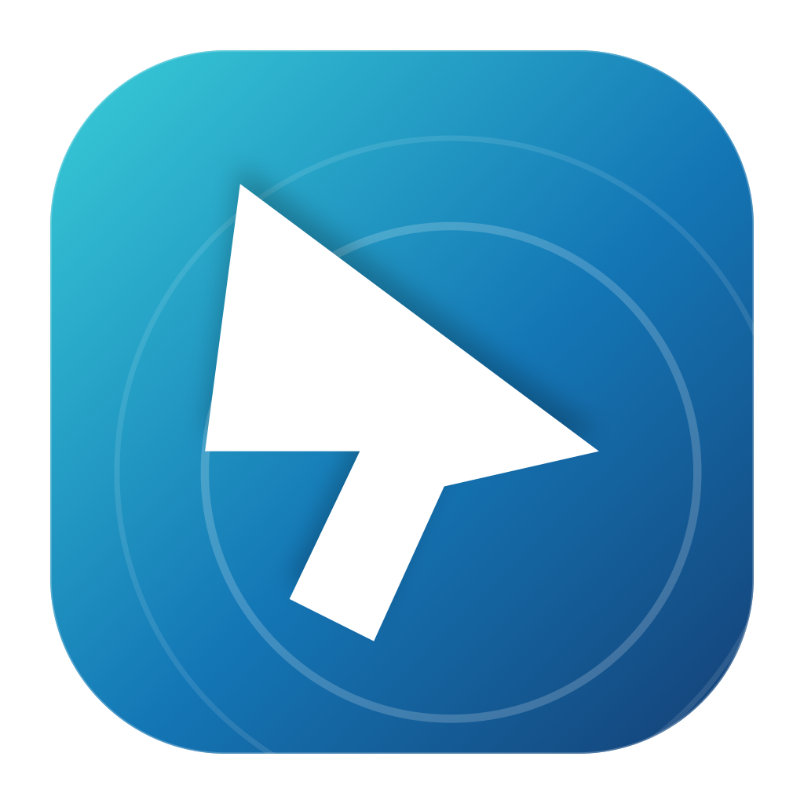

<p align="center"></p>
<h1 align="center">The Cursor</h1>
<p align="center">Your Mac trackpad and keyboard. Your unlocked iPhone.</p>
<p align="center"><a href="#quick-start">Get started</a> · <a href="#optional-screen-viewing">Screen viewing</a> · <a href="#troubleshooting">Troubleshooting</a> · <a href="LICENSE">MIT license</a></p>

The Cursor turns a Mac into a Bluetooth mouse and keyboard for a physical iPhone.
Click the proportional pad to capture your Mac pointer; press **Esc** to release
it. Use the blank pad by default, or enable an optional live iPhone view over
Wi-Fi or USB. The Mac controls the phone, not the other way around.

**Experimental source project.** Pointer control, direct swiping and a wireless
screen stream have been observed on physical hardware. Full acceptance testing,
including reconnection, keyboard behavior and prolonged streaming, is incomplete.
This is not a notarized Mac release or an App Store iPhone app. Compatibility
with every Mac/iPhone combination is not guaranteed.

## Features

- Native Mac app with a proportional blank pad and a large optional phone view.
- iPhone companion for QR setup, session management and screen-sharing consent.
- Bluetooth pointer, clicks, held dragging/swipes, scroll and keyboard reports.
- Saved local pairing identity, reconnect attempts and explicit Forget pairing.
- Optional encrypted local Wi-Fi viewing or explicitly selected USB viewing.
- No account, subscription, cloud relay, analytics or third-party Swift packages.

## Requirements

| Component | Requirement |
| --- | --- |
| Build environment | A Mac with full Xcode 26+, Swift 6 and Python 3 |
| Mac application | macOS 14+ and Bluetooth LE peripheral support |
| iPhone control | Physical iPhone, iOS 17+, Bluetooth and AssistiveTouch |
| Wi-Fi screen viewing | iOS 27+, same local Wi-Fi, Local Network permission |
| USB screen viewing | Unlocked iPhone, trusted Mac and USB data cable |
| iPhone installation | Your own Apple development signing team and Developer Mode |

The build machine must run a macOS version supported by your Xcode installation.
Wireless capture requires Xcode 27.2+ and the iOS 27 ScreenCaptureKit SDK.
Older SDKs build Bluetooth control with an explicit wireless-unavailable message. Input supports portrait orientation. The simulator cannot
validate physical Bluetooth HID or iPhone screen capture compatibility.

## Quick start

### 1. Clone and prepare Xcode

```sh
git clone https://github.com/sirnaeemasghar/the-cursor.git
cd the-cursor
```

Open full Xcode and complete first-launch setup. Scripts select
`/Applications/Xcode.app/Contents/Developer` when available. If Xcode is elsewhere,
set `DEVELOPER_DIR` to its `Contents/Developer` folder.

### 2. Build the Mac app

```sh
./scripts/build-mac.sh
open "build/The Cursor.app"
```

This compiles, packages the icon/notices and ad-hoc signs a **development** app.
It is not Developer ID signed or notarized. Build from source; do not disable
Gatekeeper to run unknown copies. **Preview** tests local capture/Esc without
sending input to a phone.

### 3. Install the iPhone companion

```sh
python3 scripts/generate-ios-project.py
open iOS/TheCursorConnect.xcodeproj
```

1. Select **TheCursorConnect → Signing & Capabilities** in Xcode.
2. Select your own development team. Change `app.thecursor.connect` to a unique
   bundle identifier if needed. This repository has no hardcoded signing team.
3. Select your physical iPhone. Initial trust/development installation may require
   a USB data cable. Enable Developer Mode if requested, then use Xcode Run.
4. Follow any on-device developer-app trust prompt. Signing expiry/availability
   depend on your Apple account; no signing certificate, profile or pre-signed IPA
   is supplied. Rebuild with your own account when needed.

The project generator owns its configuration. To preserve a custom bundle ID
across regeneration, update `PRODUCT_BUNDLE_IDENTIFIER` in
`scripts/generate-ios-project.py` too. `build-ios.sh` regenerates the project and
can overwrite manual signing edits; use Xcode Run after choosing your team.
Wireless Xcode deployment can be configured after initial device pairing where
supported. **Installation is separate from runtime use:** Bluetooth control and
Wi-Fi viewing do not need USB after installation.

### 4. Pair and control

1. On Mac choose **Connect iPhone** and allow Bluetooth access.
2. Open **The Cursor Connect** on iPhone, scan the Mac code, and allow QR camera
   and Bluetooth access. The iPhone Camera can also open the app's pairing link.
3. Pair the Mac in iPhone Bluetooth settings. For pointer-device discovery, check
   **Accessibility → Touch → AssistiveTouch → Devices → Bluetooth Devices** too.
   iOS may show your Mac's Bluetooth name rather than “The Cursor”.
4. Enable **Accessibility → Touch → AssistiveTouch**.
5. Wait for Mac input status to be ready. “Setup linked” in the companion alone
   does not prove that the OS mouse/keyboard subscriptions are ready.
6. Open Calculator or an unsent Notes draft on iPhone. Click the Mac pad once to
   capture; the activation click does not tap the phone. Subsequent clicks do.
7. Press **Esc** to release the Mac pointer and held input.

Keep only the intended phone connected during prototype testing. Multiple fully
subscribed HID hosts disable input rather than receiving guessed clicks. The QR
setup companion and OS HID host are not yet cryptographically correlated.

## Move, swipe and type

Move the trackpad while captured, click normally, or click and hold while moving
to drag/swipe. Scroll with the trackpad. Select an editable field on iPhone before
typing. The iPhone hardware-keyboard layout determines characters.

Esc stays local. Focus loss, resize and detected transport loss release capture;
these paths still need the physical checks in the device checklist. Clipboard
sync and arbitrary Unicode/emoji injection are not implemented. AssistiveTouch
controls pointer appearance; a Mac-style arrow and instant phone-pointer hiding
on Esc are not guaranteed.

## Optional screen viewing

### Wi-Fi

1. Put both devices on the same local Wi-Fi network.
2. On Mac select **Wi-Fi** and turn **Screen view** ON.
3. On iPhone (iOS 27+) tap **Share screen** and approve Apple's system prompt.
   Allow Local Network access on both devices.
4. Leave the companion to view other apps. Input still travels over Bluetooth.
5. Stop with **Stop sharing**, the iPhone system sharing control, or the Mac toggle.
   A connected Mac sends an authenticated stop to the phone.

No USB is needed during Wi-Fi use. Video targets up to 15fps with a 1280-pixel
longest edge. Late frames are dropped under pressure. Video is encrypted and
held in memory, not saved; audio/microphone capture is disabled. Protected content
may appear blank. Network loss retries during active sharing consent. Locking or
OS policy can end capture and require a new user-approved start.

### USB

Select **USB**, connect an unlocked iPhone with a data cable, trust the Mac and
turn Screen view ON. Allow Camera permission: macOS exposes the USB iPhone feed
as a capture device. The app selects muxed iOS devices and never opens the Mac
webcam. Wireless mode never silently falls back to USB.

## Reconnection and stopping

Pairing identities stay in local Keychain. **End session** pauses control;
**Forget pairing** removes app setup and requires scanning again. OS Bluetooth
bonding is managed separately in Settings. No live connection survives power-off,
and recovery across every radio/sleep/OS state is not guaranteed.

Open both apps and enable Bluetooth to reconnect. Use **Reconnect** or **Try again**
when offered. Rebuilt ad-hoc Mac apps may trigger a Keychain prompt for the saved
identity; respond to the expected macOS prompt. The current startup path can wait
for that response before opening its window.

## Troubleshooting

| Symptom | Check |
| --- | --- |
| Encryption timeout / Finish pairing | Complete OS Bluetooth pairing, return to companion and tap Try again. QR setup does not replace OS pairing. |
| Settings says Connected but setup fails | Confirm Mac app is running/advertising and retry companion setup. Existing bonding/GATT caches may need diagnosis; do not automatically forget a working link. |
| No pointer | Enable AssistiveTouch, confirm Mac input readiness and click the pad. Test in Calculator. |
| Mouse works but keyboard is not ready | After a changed HID report map, one-time OS forget/re-pair may refresh the cache. |
| Wi-Fi view is waiting | Check iOS 27+, same network, Local Network permission and active screen-sharing consent. Guest-network isolation or VPN routing can block discovery. |
| Video ends after lock/restart | Unlock and start sharing again. System consent is never bypassed. |
| USB video is blank | Check data cable, Trust, unlocked phone, Camera permission and other capture apps. |
| Mac window does not open after rebuilding | Look for an expected Keychain prompt behind other windows. |
| iPhone app will not install or expires | Check your team, unique bundle ID, Developer Mode and Xcode signing diagnostics. |

## Validation

```sh
./scripts/test.sh
./scripts/build-mac.sh release
./scripts/build-ios.sh
```

The iOS check produces an **unsigned** app that cannot be installed as-is. Core
tests cover coordinates, HID/keyboard state, queue ordering, pairing validation,
wireless mutual authentication, frame integrity/replay and size bounds.
Successful builds/tests do not prove device compatibility. Complete
[device acceptance](docs/DEVICE_TESTING.md) before declaring a stable release.
CI uses the runner's available SDK: older SDKs compile the Bluetooth companion
fallback; Xcode 27.2+ also compiles wireless capture. A passing older-SDK build
does not validate the wireless implementation.

## Source layout

```text
Sources/CursorCore/       Input reports, pairing and encrypted frame protocol
Sources/CursorDesign/     Shared theme, logo and author credit
Sources/TheCursor/        Mac UI, capture, Bluetooth and screen reception
iOS/TheCursorConnect/     QR setup and iOS 27 wireless screen sender
Tests/                   Shared-core tests
Resources/               Original artwork and Mac metadata
scripts/                 Build, test, artwork and iOS project generation
```

## Privacy and security

No personal screenshots, pairing keys, device IDs, signing profiles or build
products belong in source control. Camera use is for QR scanning or the selected
USB feed. Keyboard input is forwarded only while the app's pad is captured;
there is no global keylogger, analytics or cloud relay.

Wi-Fi viewing opens a local Bonjour listener only when enabled. Both devices
prove knowledge of the QR pairing secret using fresh HMAC challenges, derive a
session key with HKDF, and protect ordered frames with AES-GCM. Pairing secrets
are not advertised. The implementation has not had an independent security audit.
The GitHub profile link opens only when tapped.

## License and credits

Original project code is MIT licensed. Bluetooth HID descriptor and measured
relative-drag adaptations include MIT-licensed upstream work; preserve
[THIRD_PARTY_NOTICES.md](THIRD_PARTY_NOTICES.md). No AGPL code is incorporated.
Original project artwork is included with the source.

---

<p align="center">Built with Love ❤️ by <strong>Naeem Asghar</strong></p>
<p align="center"><a href="https://github.com/sirnaeemasghar"></a></p>
